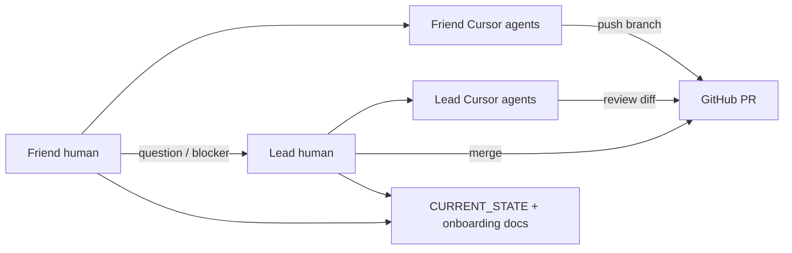

# Collaboration — humans + Cursor agents

## Can we make a group chat of agents (like Grokbot)?

**Not in Cursor the way Grokbot does.** Cursor chats are tied to **one person’s Cursor account / window**. There is no built-in “invite my friend so his agents and my agents share one room.”

| Want | Use instead |
|------|-------------|
| Friend asks product/architecture questions | **Human chat** (WhatsApp/Discord/Slack) → lead answers or pastes into **lead’s** Cursor |
| Friend needs code help on a slice | Friend’s **own** Cursor worker + [ASSISTANT_AGENT_BASELINE.md](ASSISTANT_AGENT_BASELINE.md) |
| Lead reviews friend’s work | **GitHub PR** — lead (and lead’s agents) review the diff |
| Shared status | `docs/CURRENT_STATE.md` + PR descriptions |
| Pair debugging | Screenshare; one person drives Cursor |

### Practical “shared brain” workflow

1. Friend works in **their** Cursor with the assistant baseline.  
2. Blockers go to the lead in a **normal group chat** (humans).  
3. If an agent should answer, **lead** pastes into lead Cursor and replies with the answer.  
4. Code always lands via **PR** so both sides see the same truth.

### What not to do

- Share one Cursor login (messy auth, no audit trail, conflicts).  
- Let two people edit the same branch without coordinating.  
- Expect Multitask Mode to replace a human assistant.

---

## Suggested human group chat norms

- Channel name e.g. `#studypilot-assistant`  
- Tags: `uat`, `blocker`, `pr-ready`, `question`  
- Paste: branch name, PR URL, screenshot, task card id  
- No API keys in chat  

---

## When friend “talks to your agents”

They don’t join your session. Options:

1. **You proxy:** they ask → you ask your lead agent → you forward answer  
2. **PR review:** you open friend’s PR in Cursor → “review this PR”  
3. **Same repo rules:** both agents read `docs/CURRENT_STATE.md` + onboarding baseline so answers stay aligned  

That is the StudyPilot equivalent of a shared agent group — **shared docs + PRs + you as relay**, not a multiplayer agent room.
